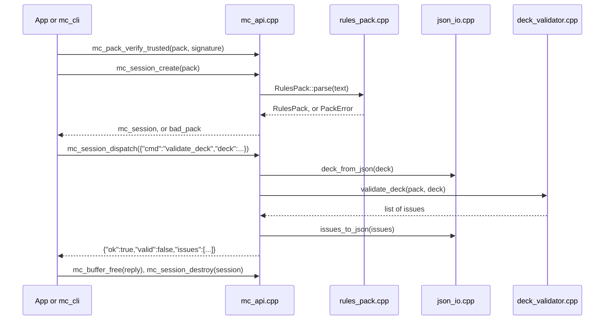

<!--
SPDX-FileCopyrightText: 2026 Daniel Martín Millet
SPDX-License-Identifier: Apache-2.0
-->

# Code tour

This guide walks through the code as it is today: what exists, how a command flows through the
core, what is tested and how to try it yourself. Requirement IDs (RF-xx for functional and
RNF-xx for non-functional requirements) and phases refer to the architecture and requirements
document, which is written in Spanish. The decisions are in [`adr/`](adr/README.md).

## Where the project stands

The project is in phase 0, the foundations. What exists is the shared C++20 core that the
Android app, the iOS app and the server will all use (ADR-01).

| Part | State |
|---|---|
| Rules packs (`mc-rules-pack` format 1) | Done: reading and checking a pack, indexing its cards, Ed25519 signature check against a given key or the trusted keys |
| Deck validation (RF-06) | Done: 17 rule codes, with the limits taken from the pack |
| C API (ADR-11) | Done: seven functions and two commands, `pack_info` and `validate_deck` |
| `mc_cli` | Done: a command-line client to try the C API by hand |
| Tests, sanitizers, coverage, fuzzing, license checks | Done, as local tasks in `tools/ci/ci.sh`; there is no remote CI |
| Android library (`libmc_core.so`, 16 KB pages) | Set up (`tools/ci/ci.sh android`); no app uses it yet |
| Pack keys (ADR-06) | Done: `mc_pack_tool` (keygen, sign, verify) and the trusted keys of the core; the development key is created by hand, and there are no release keys yet |
| Android app, account service, server, iOS app | Not started (phases 1 to 5) |

The official Malediction content is not part of the code: the tests use made-up cards
(ADR-12).

## Map of the code

```text
core/include/mc/mc_api.h                C API: the only thing the apps see
core/include/mc/core/card.hpp           Card, CardType, Rank and their text codes
core/include/mc/core/rules_pack.hpp     RulesPack, PackInfo, DeckRules and PackError
core/include/mc/core/deck.hpp           Deck and DeckEntry
core/include/mc/core/deck_validator.hpp Rule codes, ValidationIssue and validate_deck()
core/include/mc/core/signature.hpp      verify_signature() (Ed25519)
core/include/mc/core/trusted_keys.hpp   trusted_keys(), verify_with_any_key() and verify_trusted()
core/src/mc_api.cpp                     The C functions: limits, command routing, error replies
core/src/rules_pack.cpp                 RulesPack::parse(): reads and checks a pack
core/src/deck_validator.cpp             The Checker class, which applies the deck rules
core/src/json_io.hpp, json_io.cpp       JSON to domain types and back (internal)
core/src/card.cpp                       Text codes of card types and ranks
core/src/signature.cpp                  The libsodium call
core/src/trusted_keys.cpp               The public keys compiled into the core
cmake/McTrustedKeys.cmake               MC_TRUST_DEV_KEY: the development key, only in Debug
core/mc_core.map                        The only symbols the shared library exports
tests/                                  GoogleTest and RapidCheck tests, C11 header check
examples/mc_cli.c                       Command-line client; examples/commands/ has sample commands
fuzz/                                   libFuzzer targets and their seed corpus
tools/pack/                             mc_pack_tool: keygen, sign and verify (development only)
content/test/rules-pack.test.json       The made-up pack used by tests, fuzzers and mc_cli
```

## How a command flows through the core

The apps (and `mc_cli`) only use the seven functions in `mc_api.h`. Data crosses the boundary as
UTF-8 JSON bytes, and no C++ exception ever crosses it.



### 1. Loading a rules pack

`mc_pack_verify_trusted` checks the detached Ed25519 signature of the pack bytes with libsodium
(`signature.cpp`) against each public key compiled into the core (`trusted_keys.cpp`): the
release keys, none yet, and, only in Debug builds with `MC_TRUST_DEV_KEY`, the development key
from `keys/dev.pub`. `mc_pack_verify` does the same with a key given by the caller. The core does
not call either on its own: the app calls one before creating a session. `mc_pack_tool`
(`tools/pack/`) creates the keys and the signatures; see the README.

`mc_session_create` rejects packs larger than 16 MiB and passes the bytes to
`RulesPack::parse` (`rules_pack.cpp`), which:

1. parses the JSON and checks that `format` is `mc-rules-pack` and `format_version` is 1;
2. reads the metadata (`id`, `version`, `date`, `origin`, `license`) and the `rules`:
   `deck_min`, `deck_max`, `side_max`, `copy_limits` per rank, and two switches that default to
   true, `unaligned_cards_allowed` and `copy_limits_include_side`;
3. reads every card: `id`, `name`, `type`, and optionally `rank` (default: none), `cost`
   (default: 0) and `sigils` (sorted and without duplicates; no sigils means an unaligned card).
   A Legacy also needs `seeker` and `starting_echo`;
4. indexes the cards by `id`, which must be unique, and checks that every Legacy points to a
   Seeker in the same pack.

Any problem throws a `PackError` that starts with the path of the field, for example
`cards[2].rank: unknown rank`. `mc_session_create` turns it into `MC_ERR_BAD_PACK` and the reply
`{"ok":false,"error":"bad_pack","detail":"..."}`. The parser also has defensive limits: at most
20,000 cards, ids of up to 64 characters, up to 8 sigils per card and numbers up to 1,000.

### 2. Running a command

`mc_session_dispatch` (`mc_api.cpp`):

1. rejects commands larger than 1 MiB (`too_large`);
2. parses the JSON (`invalid_json`) and requires an object with a `cmd` string (`missing_cmd`);
3. sends `pack_info` and `validate_deck` to their handlers; any other command is
   `unknown_command`.

For `validate_deck`, `deck_from_json` (`json_io.cpp`) turns the `deck` object into a `Deck`.
Missing or `null` slots count as empty; `main` and `side` must be lists of `{"card","copies"}`
with at most 500 lines, and `copies` must be an integer that fits in an `int`. A deck with the
wrong shape is a `bad_deck` error. A deck that breaks the rules is not an error: it gets a
normal reply with `"valid":false` and the list of issues.

Every reply is copied into a new buffer that ends with a null byte (`copy_out`), and the caller
frees it with `mc_buffer_free`. Every C function is `noexcept` and catches everything; at worst
it returns `MC_ERR_INTERNAL`.

### 3. Validating a deck

`validate_deck` (`deck_validator.cpp`) creates a `Checker` and runs these steps in order:

| Step | Rule codes |
|---|---|
| Seeker: chosen, in the pack and of type `seeker`. Without a valid Seeker the steps below do not run, so this is the only issue | `seeker_missing`, `seeker_invalid` |
| Legacy: present, of type `legacy`, belonging to that Seeker | `legacy_missing`, `legacy_wrong_type`, `legacy_mismatch` |
| Terrain: present, of type `terrain`; it can be of any faction | `terrain_missing`, `terrain_wrong_type` |
| Each line of the main deck and the side deck: at least one copy, a known card, a type that goes in the deck (unit, spell or item), a rank with a copy limit, and only sigils that the Seeker has | `invalid_copies`, `unknown_card`, `card_type_not_allowed`, `rank_not_allowed`, `sigil_mismatch` |
| Copies of each card, adding up repeated lines and, by default, the side deck | `too_many_copies` |
| Cards that should not be in the deck: unknown, of a type or rank that is not allowed, or with sigils the Seeker does not have | `deck_has_invalid_cards` |
| Sizes: main deck between `deck_min` and `deck_max`, side deck up to `side_max` | `deck_too_small`, `deck_too_large`, `side_too_large` |

An issue about a card is reported once, even if the card is on several lines. Every copy counts
towards the size, also the copies of cards that should not be in the deck: those cards get their
own issue, and the deck as a whole also gets `deck_has_invalid_cards`, which says how many of them
each deck has. A Seeker with two factions accepts the cards of either faction and the cards of
both. With the test pack, a deck
has 30 to 50 cards and up to 7 in the side deck, with 3, 2 and 1 copies for basic, elite and
unique cards; legendary cards have no copy limit in the pack, so they cannot go in the deck.

Each issue has a stable `rule` code, which the app will translate for players, the `card` it
refers to when there is one, and a `detail` in English for debugging.

## What is tested

| File | What it covers |
|---|---|
| `tests/card_test.cpp` | Type and rank codes go both ways; unknown names are rejected; rule codes are unique and in snake_case |
| `tests/rules_pack_test.cpp` | The test pack; defaults; sorted sigils; every kind of malformed pack is rejected with the path of the field |
| `tests/deck_validator_test.cpp` | Each rule on its own: Seeker, Legacy, terrain, sizes, side deck, copy limits (also across lines and with the side deck), types, ranks, sigils, unaligned cards, cards that should not be in the deck and very large copy counts |
| `tests/deck_properties_test.cpp` | Properties checked by RapidCheck on hundreds of random decks: legal cards within their limits only fail on size, order and split lines do not change the result, going over a limit is always detected, cards that should not be in the deck always count towards the size and mark it, without a valid Seeker that is the only issue, and validation is deterministic |
| `tests/signature_test.cpp` | Ed25519 with the RFC 8032 test vector; a modified pack, a modified signature, another key and wrong sizes are rejected |
| `tests/trusted_keys_test.cpp` | Several keys with the signer in any position, no matching key, altered packs and signatures, and no test key among the trusted ones |
| `tests/trusted_keys_build_test.cpp` | Built twice with a test development key: it is trusted with `MC_TRUST_DEV_KEY` and rejected without it |
| `tests/CMakeLists.txt` (`cmake.dev_key_*`) | CMake refuses the development key outside Debug and leaves it off by default in Release |
| `tests/pack_tool_test.cpp` | `mc_pack_tool` with fixed seeds and the lowest Argon2id limits: keygen, sign and verify end to end, wrong password, altered key file, pack or signature, limits stored in the file, no overwriting and the command line |
| `tests/c_api_test.cpp` | The C API as the apps will use it: sessions, null-terminated buffers, every error code, size limits, argument checks and signatures |
| `tests/c_header_check.c` | `mc_api.h` compiles as C11 and links from C |
| `examples/CMakeLists.txt` | `mc_cli` on each example command |
| `fuzz/` | libFuzzer with random packs and random commands: the core must never crash and must always answer with JSON |

Before every commit, `tools/ci/ci.sh all` runs locally: formatting and clang-tidy, the tests with
AddressSanitizer and UBSan, ThreadSanitizer and Release, at least 90 % line coverage of `core/src`
(RNF-17), the fuzzers, the Android build and the license checks. There is no remote continuous
integration.

Not covered yet: real Malediction cards (the official pack stays private and is tested only on
the development machine), `mc_pack_tool keygen` with the real Argon2id limits and the terminal
password prompt (they need 1 GiB and a person at the keyboard) and, naturally, the apps.

## Try it yourself

Every command below runs in Ubuntu (WSL), in the project folder, after `tools/dev/setup-wsl.sh`
([`local-environment.md`](local-environment.md)).

### Run the tests

```sh
tools/ci/ci.sh asan
```

This configures the `asan` preset in `$MC_BUILD_ROOT/asan`, builds the core, the tests and
`mc_cli`, and runs every test with AddressSanitizer and UBSan. Afterwards you can rebuild and run
just some of the tests:

```sh
cmake --build "$MC_BUILD_ROOT/asan"
ctest --test-dir "$MC_BUILD_ROOT/asan" -R DeckValidator --output-on-failure
"$MC_BUILD_ROOT/asan/tests/mc_core_tests" --gtest_filter='RulesPack.*'
```

### Use the core by hand with mc_cli

```sh
cli="$MC_BUILD_ROOT/asan/examples/mc_cli"
pack=content/test/rules-pack.test.json
"$cli" "$pack" examples/commands/pack-info.json
"$cli" "$pack" examples/commands/invalid-deck.json | python3 -m json.tool
echo '{"cmd":"validate_deck","deck":{"seeker":"T-SEEK-ASH"}}' | "$cli" "$pack"
```

`invalid-deck.json` breaks nine rules at once. Part of the reply:

```json
{
    "card": "T-TIDE-U01",
    "detail": "card sigils: tide; Seeker sigils: ash",
    "rule": "sigil_mismatch"
},
{
    "detail": "cards that should not be in the deck: 5 of 12 in the main deck",
    "rule": "deck_has_invalid_cards"
}
```

To try your own deck, copy `examples/commands/valid-deck.json`, change it and run it the same
way; the card ids are in the test pack. `mc_cli` exits with 0 when the core answers `MC_OK`, 1
when it rejects the pack or the command, and 2 for usage or file errors.

### Break it on purpose

A quick way to see the tests at work:

1. In `core/src/deck_validator.cpp`, in `check_limits`, change `count.copies > limit->second` to
   `count.copies >= limit->second`.
2. Run `cmake --build "$MC_BUILD_ROOT/asan" && ctest --test-dir "$MC_BUILD_ROOT/asan"`. About a
   dozen tests fail. The RapidCheck property prints `Falsifiable after ... tests and ... shrinks`,
   the smallest deck that breaks it and the seed to replay it.
3. Undo the change with `git restore core/src/deck_validator.cpp`.

You can do the same with the data: in a copy of the test pack, set `"deck_min": 40` and run
`valid-deck.json` against it with `mc_cli`; the reply becomes `deck_too_small`.

### Other checks

```sh
tools/ci/ci.sh coverage                  # coverage report in $MC_BUILD_ROOT/coverage/html
MC_FUZZ_SECONDS=30 tools/ci/ci.sh fuzz   # each fuzzer for 30 seconds
tools/ci/ci.sh lint                      # clang-format and clang-tidy
tools/ci/ci.sh android                   # Android library and the 16 KB check
```

## Reading the code in VS Code

Open the folder from Ubuntu with `code .` and set up clangd with the compilation database of the
`asan` build ([`local-environment.md`](local-environment.md#5-vs-code-from-wsl) has the steps).
A good reading order:

1. `core/include/mc/mc_api.h`: the contract with the apps.
2. `core/src/mc_api.cpp`: `mc_session_create` and `dispatch`.
3. `core/src/rules_pack.cpp`: `RulesPack::parse`.
4. `core/src/deck_validator.cpp`: `Checker::run` and its steps.
5. `tests/deck_validator_test.cpp`: one small example per rule.

With clangd, F12 goes to a definition and Shift+F12 lists its references.

## What comes next

Phase 1 is the Android app with decks and local matches, with the official cards and theme from
the private pack and the server's account service (ADR-05). In terms of code:

- In the core: importing decks from the text that malediction.gg exports (RF-10), the counters
  and the match event reducer (ADR-01 and ADR-04).
- An Android Studio project in Kotlin with Jetpack Compose that builds `libmc_core.so` through
  Gradle and calls the C API through a thin JNI layer (ADR-02 and ADR-11).
- The account service on the server (ADR-03 and ADR-05).
- Still open from phase 0: creating the development key with `mc_pack_tool keygen dev` and
  copying `dev.pub` to `keys/` (ADR-06).
